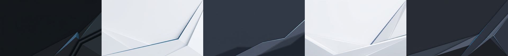
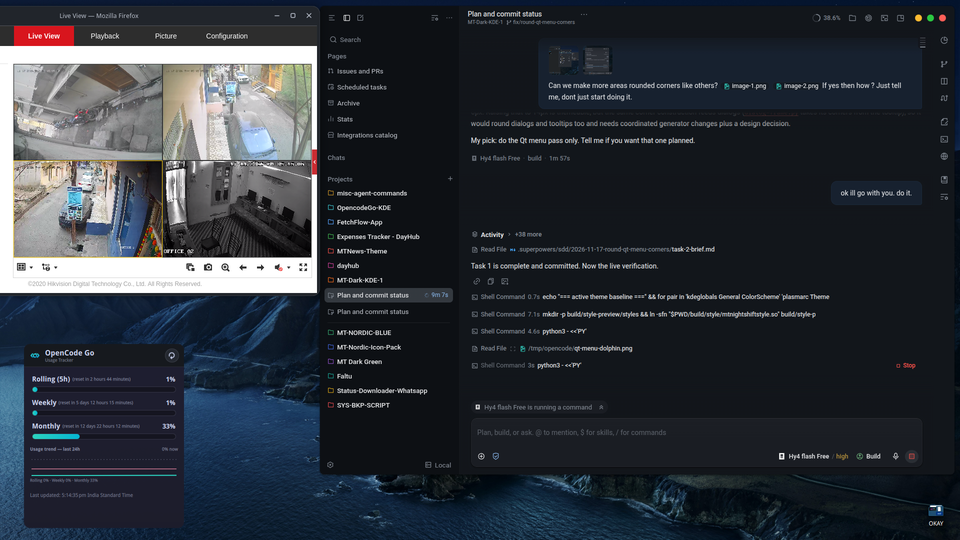
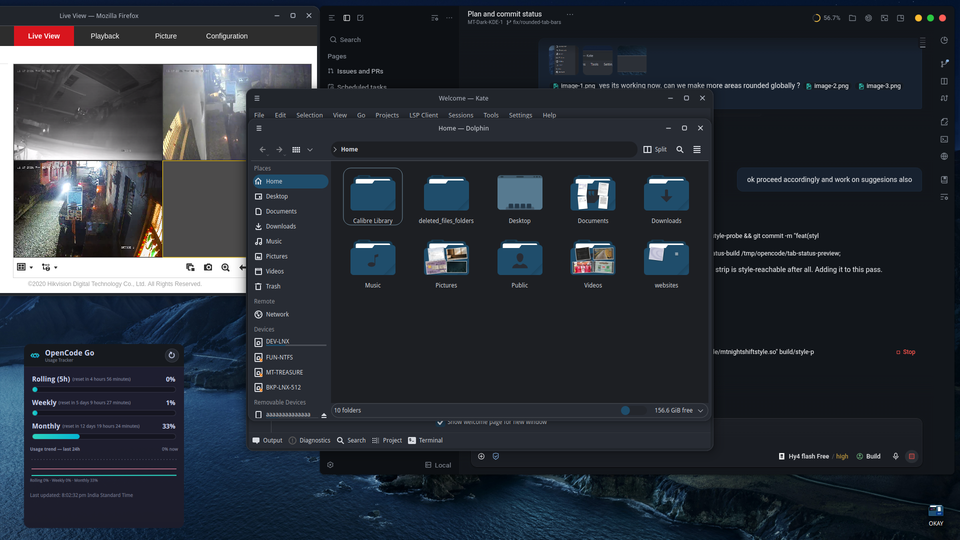
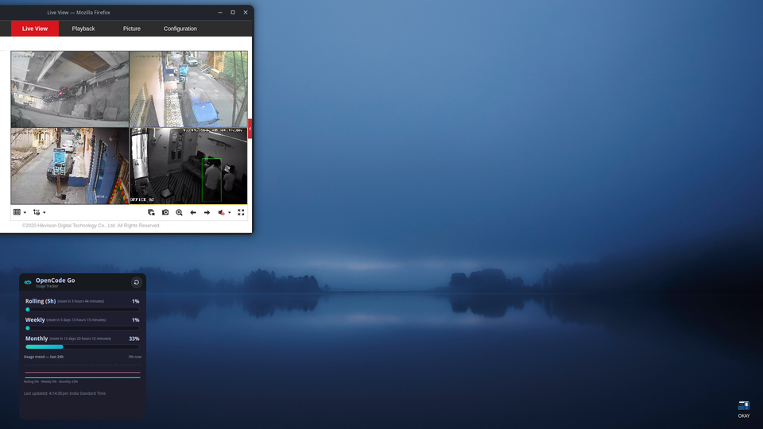

© Mayanktaker Computers & Web Development | https://mayanktaker.com

# MT Dark KDE

[](https://github.com/Mayanktaker/MT-Nightshift-KDE/actions/workflows/checks.yml)

A modern, sculptured evolution of KDE Breeze for KDE Plasma 6. Built around **Nightshift OLED** (near-black carbon surfaces, restrained steel-blue highlights, and deliberate, solid geometry instead of distracting blur or glossy 3D effects), this suite provides 5 cohesive palette variants, custom 15px rounded Aurorae window decorations, a dedicated C++ Qt Widgets application style plugin, and a matching 20-wallpaper abstract collection.



---

## Visual Previews

| Rounded Context Menus & Path Bar | Dolphin Statusbar & 12px Gutters | One Dark Pro Live Desktop |
|---|---|---|
|  |  |  |

---

## Features

- **5 Hand-Crafted Variants**: Seamlessly switch between Nightshift (OLED carbon), Dayshift (crisp light), Nord Night (Polar Night slate), Nord Day (Snow Storm), and One Dark Pro (vibrant dark).
- **15px Rounded Window Decorations**: Aurorae theme generated with clean 15px rounded corners, continuous shadow envelopes, and 5 distinct window title bar buttons (close, minimize, maximize, keep-above, help) color-matched to each look.
- **C++ Qt Widgets Style Plugin (`MTNightshift`)**:
  - Consistent ~15px corner radii on buttons, input fields, spinboxes, combo boxes, menus, and tool buttons.
  - Borderless, rounded path bar in Dolphin (`KUrlNavigator`) with focus ring.
  - Slim 12px scrollbar gutters across all Qt applications with clean sidebar gutter suppression in Dolphin.
- **Plasma 6 Desktop Theme & Popups**: 14px rounded panel and popup frames (`widgets/background`), solid dialog backgrounds (`dialogs/background`), and high-contrast widget styling.
- **20 Palette-Matched Abstract Wallpapers**: High-definition, text-free abstract wallpapers for all 5 variants across 16:9 Full HD (`1920x1080`), 32:9 Dual-FHD (`3840x1080`), 32:9 Dual-QHD (`5120x1440`), and 16:9 4K UHD (`3840x2160`).
- **Rigorous Contrast & Accessibility Standards**: All variants enforce WCAG AA text contrast floors (minimum 4.66:1) and strong UI element contrast (minimum 3.0:1) verified via automated testing.

---

## The Five Variants

| Variant | Style | Dominant | Deep / Lightest | Mid Surface | Accent | Highlight |
|---|---|---|---|---|---|---|
| **Nightshift** | Dark (OLED) | `#101216` | `#0A0B0D` | `#1B1F25` | `#1F6E9C` | `#4FB4E6` |
| **Dayshift** | Light | `#EFF1F5` | `#FAFBFD` | `#F4F6F9` | `#1F6E9C` | `#256D9F` |
| **Nord Night** | Dark (Slate) | `#2E3440` | `#232932` | `#3B4252` | `#84A5C6` | `#A9CEE0` |
| **Nord Day** | Light (Cool) | `#ECEFF4` | `#F7F9FC` | `#E5E9F0` | `#4C6B91` | `#1F5F8C` |
| **One Dark Pro** | Dark | `#282C34` | `#1D1F23` | `#404754` | `#528BFF` | `#7FBEF2` |

---

## Installation & Quick Start

### Prerequisites

For building the Qt Widgets style plugin and running verification checks, ensure the required toolchain and libraries are installed:

- **Fedora**:
  ```bash
  sudo dnf install -y cmake extra-cmake-modules gcc-c++ qt6-qtbase-devel libxml2 python3-pillow python3-numpy
  ```
- **Arch Linux**:
  ```bash
  sudo pacman -S --needed cmake extra-cmake-modules gcc qt6-base libxml2 python-pillow python-numpy
  ```
- **Ubuntu / Debian** (24.04+):
  ```bash
  sudo apt-get install -y cmake extra-cmake-modules g++ qt6-base-dev libxml2-utils python3-pillow python3-numpy
  ```

---

### Quick Installation (Automated via Make)

The repository provides automated recipes in the `Makefile` to install all data packages user-locally and apply any variant to your running Plasma session:

```bash
# Clone the repository
git clone https://github.com/Mayanktaker/MT-Nightshift-KDE.git
cd MT-Nightshift-KDE

# Install and apply the default MT Nightshift look
make apply

# Or switch directly to any variant
make apply-dayshift       # Applies MT Dayshift
make apply-nord-night     # Applies MT Nord Night
make apply-nord-day       # Applies MT Nord Day
make apply-one-dark-pro   # Applies MT One Dark Pro
```

#### Installing the C++ Qt Widgets Style Plugin (Optional but Recommended)

Because Qt 6 scans `/usr/lib64/qt6/plugins/styles/` for system style plugins, installing the compiled style plugin requires root permissions:

```bash
# Build and install the Qt Widgets style plugin
make style-install
```

After installing, start any Qt Widgets application (e.g. Dolphin) or select `MTNightshift` under **System Settings → Appearance → Application Style**.

---

### Manual / User-Local Installation

If you prefer installing components manually without the `Makefile`:

1. **Aurorae Window Decorations**:
   ```bash
   install -d ~/.local/share/aurorae/themes/
   cp -r themes/aurorae/* ~/.local/share/aurorae/themes/
   ```

2. **Global Color Schemes**:
   ```bash
   install -d ~/.local/share/color-schemes/
   cp color-schemes/*.colors ~/.local/share/color-schemes/
   ```

3. **Plasma Desktop Themes**:
   ```bash
   install -d ~/.local/share/plasma/desktoptheme/
   for style in mt-nightshift mt-dayshift mt-nord-night mt-nord-day mt-one-dark-pro; do
       cp -r themes/$style ~/.local/share/plasma/desktoptheme/
   done
   ```

4. **Global Theme (Look-and-Feel Packages)**:
   ```bash
   for pkg in mt-nightshift-global mt-dayshift-global mt-nord-night-global mt-nord-day-global mt-one-dark-pro-global; do
       kpackagetool6 --type Plasma/LookAndFeel -i themes/$pkg || \
       kpackagetool6 --type Plasma/LookAndFeel -u themes/$pkg
   done
   ```

5. **Activate via Command Line**:
   ```bash
   # Select the Global Look-and-Feel package
   plasma-apply-lookandfeel -a com.mayanktaker.mt-nightshift.desktop

   # Set optimal frame contrast and reconfigure KWin
   kwriteconfig6 --file kdeglobals --group KDE --key frameContrast 0.05
   gdbus call --session --dest org.kde.KWin --object-path /KWin --method org.kde.KWin.reconfigure
   ```

---

### Distributable Packages (KDE Store & Standalone Releases)

Build distributable `.tar.gz` archives for all five variants in `dist/`:

```bash
make package
```

This creates:
- **Complete Suite Tarballs**: `dist/MT-<Variant>-v1.6.0.tar.gz` (contains Look-and-Feel, desktop theme, Aurorae decoration, color scheme, matching wallpapers, and a standalone `install.sh` script).
- **KDE Store Look-and-Feel Packages**: `dist/com.mayanktaker.<style>.desktop-1.6.0.tar.gz`.
- **KDE Store Aurorae Decoration Packages**: `dist/aurorae-<decoration>-1.6.0.tar.gz`.

---

## Desktop Wallpapers

The `Wallpapers/` directory contains 20 minimal, text-free abstract wallpapers specifically composed and color-matched for each theme variant:

- **16:9 Full HD (`1920x1080`)**: Perfect for standard displays (`nightshift-abstract-1920x1080.png`, etc.)
- **32:9 Panoramic Dual-FHD (`3840x1080`)**: Ideal for dual-1080p monitor spans
- **32:9 Panoramic Dual-QHD (`5120x1440`)**: High-res panoramic edition for dual-1440p monitors
- **16:9 4K UHD (`3840x2160`)**: Ultra-high definition 4K edition

### Setting a Wallpaper

Global themes in this repository deliberately omit wallpaper defaults to preserve user customization. Apply any wallpaper from the terminal:

```bash
plasma-apply-wallpaperimage Wallpapers/nightshift-abstract-1920x1080.png
```

Or for dual-monitor setups:
```bash
plasma-apply-wallpaperimage Wallpapers/nightshift-abstract-3840x1080.png
```

See [`Wallpapers/README.md`](Wallpapers/README.md) for master prompts, palette blocks, and regeneration instructions.

---

## Quality Assurance & Verification

This project features a comprehensive offscreen testing suite:

```bash
# Run all automated tests
make check
```

What `make check` asserts:
- **Aurorae Invariants**: Verifies continuous shadow ramps, lack of corner cutouts, and 15px border geometry across all variants (`tools/decoration-probe/check-decoration.py`).
- **Button Palette Audit**: Proves all 5 buttons and 8 interaction states match each variant's color scheme (`tools/decoration-probe/check-buttons.py`).
- **Package Integrity & Contrast**: Confirms byte-identical palette copies across packages and verifies that all 64 text/surface pairs meet or exceed the 4.66:1 contrast floor (`tools/theme-audit/check-theme.py`).
- **Wallpapers Verification**: Validates file presence, exact target dimensions, and PNG optimization (`tools/wallpapers/build-wallpapers.py --check`).
- **Qt Style Probe**: Offscreen Qt probe rendering test widgets through the built plugin and asserting 15px tapers, 1px focus rings, 12px scrollbar gutters, and meter accent fills (`tools/style-probe/check-style.py`).

To verify that your currently running session matches the active theme:
```bash
make verify-live VARIANT=nightshift
```

---

## Project Structure

```
├── application-style/       # C++ Qt Widgets style plugin (source, kstyle themerc)
├── color-schemes/           # Master KDE color schemes (.colors)
├── docs/                    # Documentation and screenshot previews
├── themes/
│   ├── aurorae/             # Aurorae window decorations (MTNightshift, MTDayshift, ...)
│   ├── mt-*-global/         # Plasma Look-and-Feel metadata packages
│   └── mt-*/                # Plasma desktop theme assets (widgets, dialogs)
├── tools/
│   ├── decoration-probe/    # Aurorae SVG generator, probe, and button validator
│   ├── packaging/           # KDE Store and release tarball packaging tooling
│   ├── plasma-theme/        # Plasma panel, dialog, and applet frame generators
│   ├── style-probe/         # Offscreen Qt Widgets widget tester
│   ├── theme-audit/         # Contrast and package metadata auditor
│   └── wallpapers/          # Wallpaper build and verification tooling
├── upstream/                # Upstream KDE Breeze 6.8.2 reference baseline
└── Wallpapers/              # 20 palette-matched wallpapers and lossless sources
```

---

## Attribution & Licensing

- Upstream theme assets and baseline are derived from [KDE Breeze](https://invent.kde.org/plasma/breeze) and [libplasma](https://invent.kde.org/plasma/libplasma) (KDE Visual Design Group). Upstream notices and per-file licenses are strictly preserved under `upstream/` and [`LICENSES/`](LICENSES/).
- Original code and artwork marked `LGPL-2.0-or-later` are covered by [`LICENSES/LGPL-2.0.txt`](LICENSES/LGPL-2.0.txt).
- The **One Dark Pro** palette is derived from Binaryify's [One Dark Pro](https://github.com/Binaryify/OneDark-Pro) (MIT, Copyright (c) 2013-2022 Binaryify); see [`LICENSES/MIT.txt`](LICENSES/MIT.txt).
- This project does not claim KDE authorship or imply KDE endorsement.
